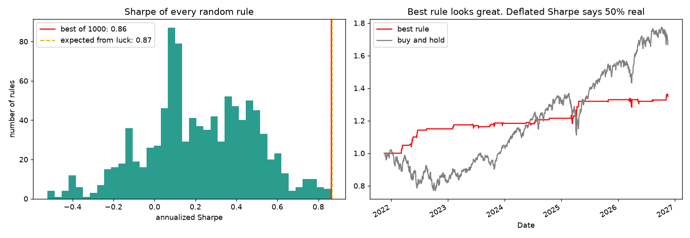

# Backtest Overfitting Detector

Generates 1,000 random trading rules, backtests them all, picks the best one, and checks whether that result is real using the Deflated Sharpe Ratio (Bailey and Lopez de Prado, 2014).

## Why this matters

If you try enough strategies, the best one will look great by pure luck. This tool measures how much of a result is luck and how much could be real.

## Run it

pip install -r requirements.txt

python detector.py --ticker SPY

## Result on SPY (5 years, 1,000 random rules)

Best rule: mean reversion, 75 day lookback

Best Sharpe: 0.86

Sharpe expected from luck alone: 0.87

Deflated Sharpe: 49.6%

The best of 1,000 random rules was no better than luck predicts.

## How it works

1. Generate random rules: moving average crossover, momentum, mean reversion, and breakout.

2. Backtest each rule with no lookahead and trading costs included.

3. Keep the rule with the highest Sharpe ratio.

4. Compute the Sharpe expected from luck alone, given the number of trials.

5. Compute the Deflated Sharpe, which adjusts for trial count, skew, and fat tails.

## Built with

Python, NumPy, pandas, SciPy, Matplotlib, yfinance
